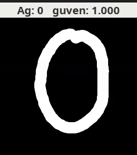

# Java ile Sıfırdan Rakam Tanıyan Sinir Ağı

A handwritten digit recognizer in a single Java file: a deep neural network written from scratch with no libraries, trained on MNIST, with a window where you draw digits and teach it your handwriting.

Tek bir Java dosyasında, kütüphane kullanmadan yazılmış bir derin sinir ağı. MNIST ile eğitiliyor, fareyle çizdiğin rakamı anlık tahmin ediyor ve yanlış bildiğinde senin el yazından öğreniyor.



## Sonuçlar

| Ölçüm | Sonuç |
|---|---|
| MNIST testi (10.000 resim) | **%98.90** (110 hata) |
| Fareyle çizilmiş 17 rakam (tek kişi, küçük örnek) | 16 doğru |

Kişisel örnek öğretince model o kişinin eline kayar: denemelerde MNIST testi %98.47 ile %98.81 arasına indi.

## Çalıştırma

Java 21 ile test edildi. Derlemeye ya da başka bir kuruluma gerek yok.

MNIST'i indir (yaklaşık 11 MB):

```bash
mkdir -p data && curl -L -o data/mnist.npz https://storage.googleapis.com/tensorflow/tf-keras-datasets/mnist.npz
```

Uygulamayı aç:

```bash
java Dnn.java
```

İlk çalıştırmada model eğitilir (yaklaşık 4 dakika) ve `models/` klasörüne kaydedilir. Sonraki açılışlar birkaç saniye sürer.

Test sonuçlarını, hata örneklerini ve confusion matrix'i görmek için:

```bash
java Dnn.java --eval
```

## Kullanım

- Tuvale bir rakam çiz, tahmin çizdikçe güncellenir.
- Yanlış bilirse alttaki butonlardan doğrusuna bas. Örnek kaydedilir ve ağ kısa bir ek eğitim yapar.
- Baştan almak için `models/mnist-model-personal.bin` ve `models/my-samples.bin` dosyalarını sil.

## Nasıl çalışıyor?

- **Ağ:** `784 → 256 → 128 → 10`. Gizli katmanlarda ReLU, çıkışta softmax, kayıp olarak cross-entropy.
- **Eğitim:** Elle yazılmış backpropagation ve örnek başına SGD. He başlatma ile 20 epoch; `lr` 0.01, son 5 epoch'ta 0.001. MNIST'in 50.000 resmi eğitim, 10.000 resmi validation için kullanılıyor.
- **Data augmentation:** Eğitimde resimler rastgele döndürülüyor, eğiliyor, ölçekleniyor ve kaydırılıyor.
- **Çizimi hazırlama:** Rakam MNIST'teki gibi 20×20 hücreye sığdırılıp kütle merkezinden ortalanıyor, sonra 28×28'e indiriliyor. Ağ konuma çok duyarlı olduğu için en büyük kazanç buradan geliyor.
- **Kişisel öğrenme:** Yeni örnek öğretilirken araya MNIST örnekleri katılıyor.

## Sınırlar

- Yalnızca tek rakam tanır; `10` gibi çok basamaklı çizimleri ayıramaz.
- Tuvalin çok küçük bir kısmına çizilen rakamlarda başarı düşer, çünkü büyütürken fırça da kalınlaşır.
- Eğik çizgili (bayraklı) 1 başlangıçta genelde 7 çıkar. Bir örnek öğretince düzeliyor, ama bu az sayıda çizimle denendi.
- Evrişimli (CNN) değil, tam bağlantılı bir ağ.

## Lisans

[MIT](LICENSE)
